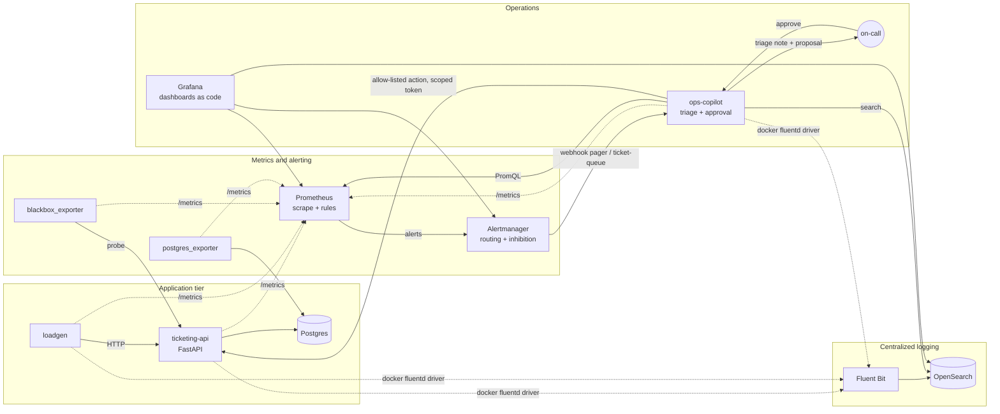

# SRE observability lab

A self-contained, runnable lab that exercises the core of modern production operations
on a toy ticket-purchase service: Prometheus metrics, SLOs with multi-window multi-burn-rate
alerting generated from a declarative spec, Alertmanager routing and inhibition, Grafana
dashboards as code, centralized JSON logging into OpenSearch, and an LLM-assisted
incident copilot that proposes remediations a human must approve. It ends with a scripted
game day and a correction-of-error review written from the real timeline.

Everything runs locally with `docker compose` in about 2.3 GiB of RAM. No cloud accounts,
no API keys required (the copilot has a deterministic rules engine; Claude is optional).

## Architecture



The spec `slo/slos.yaml` is the source of truth for SLOs. `tools/slo_gen.py` turns it into
Prometheus recording and alerting rules (`prometheus/rules/generated/`), which promtool unit
tests exercise with synthetic traffic. In a real organization that role is played by Nobl9
(or Sloth/Pyrra); here the spec plus generator stands in for it.

## What it demonstrates

| Area | What is here |
|---|---|
| Instrumentation | RED metrics with low-cardinality route templates, latency histogram with buckets around the SLO threshold, in-flight gauge, chaos gauges; structured JSON logs with request ids |
| SLOs | Availability 99.9% and latency 99% (< 500 ms) over 30 days; SLI, burn-rate and error-budget-remaining recording rules per window |
| Alerting | Google SRE Workbook multi-window multi-burn-rate ladder: page at 14.4x (1h/5m) or 6x (6h/30m), ticket at 3x (1d/2h) or 1x (3d/6h). promtool tests prove a fast burn pages, a slow burn tickets, a short blip does not page |
| Alert hygiene | Every alert carries severity, service, summary, description, runbook_url and dashboard_url. Routing by severity to a pager and a ticket queue with deliberate group/repeat timings; a page inhibits its own ticket; a dependency-down alert inhibits downstream symptoms. Routing verified with `amtool config routes test` |
| Dashboards | SLO overview (SLI, budget, burn per window, firing alerts), golden signals, Postgres, all provisioned from generated JSON |
| Logging | Docker fluentd driver -> Fluent Bit forward input -> JSON parse -> OpenSearch daily indices with an index template and an ISM retention policy; Grafana OpenSearch datasource for metric/log correlation by `request_id` |
| Incident copilot | Alertmanager webhook -> dedupe by fingerprint -> deterministic read-only context (PromQL, OpenSearch, runbook) -> triage note (Claude with structured output, or a rules engine offline) -> allow-listed proposals -> human approval with identity -> append-only JSONL audit. Adversarial tests: a log line telling the model to run a destructive command cannot produce a non-allow-listed action |
| Game day and COE | `make gameday` injects a fault and records the real detection, routing, triage, approval and resolution timestamps; `docs/coe/` holds a correction-of-error review written from one run |
| Alert noise | `tools/alert_noise_report.py` reconstructs firing episodes from `ALERTS` history: counts, flaps, time-to-resolve, and pruning recommendations |

## Quickstart

Requirements: Docker Desktop (or any Docker with Compose v2), `uv`, `make`. Host ports used:
3000, 8000, 8001, 9090, 9093, 9200, 2020, 24224.

```bash
cp .env.example .env            # lab defaults; set ANTHROPIC_API_KEY to enable the LLM path
make up                         # build + start; first run pulls images (~1.5 GB)
make targets                    # every Prometheus target should be "up" within a minute
open http://localhost:3000      # Grafana, anonymous viewer (admin/admin to edit)
```

Run the scripted incident:

```bash
make gameday APPROVER="Your Name"     # injects 50% errors, waits for the page, then for you
# in another shell, when prompted:
make incidents
make approve INCIDENT=inc-... ACTION=0 APPROVER="Your Name"
```

Or break things by hand and watch: `make chaos-errors`, `make chaos-latency MS=800`,
`make chaos-db`, `make chaos-reset`. Alerts: http://localhost:9090/alerts and
http://localhost:9093. Copilot incidents: http://localhost:8001/incidents.

Quality gate (what CI runs): `make test` = ruff, yamllint, pytest, generated-rules and
dashboards freshness checks, `promtool check` and `promtool test rules`, `amtool check-config`
plus routing assertions, `docker compose config`.

Stop: `make down` (volumes kept) or `make clean` (volumes and local data removed).

## Repository map

```
slo/slos.yaml                      SLO spec (the thing humans edit)
tools/slo_gen.py                   spec -> Prometheus rules (multi-window multi-burn-rate)
tools/gen_dashboards.py            Grafana dashboards as code
tools/gameday.py                   scripted incident with real timestamps
tools/alert_noise_report.py        alert history -> counts, flaps, TTR, recommendations
tools/copilotctl.py                list / show / approve / reject incidents
prometheus/                        scrape config, generated + static rules, promtool unit tests
alertmanager/                      routing tree, inhibition, amtool routing assertions
grafana/                           provisioning (datasources, dashboards)
fluent-bit/, opensearch/           log pipeline, index template, ISM retention, bootstrap
services/ticketing-api/            FastAPI toy service: metrics, JSON logs, chaos endpoints
services/loadgen/                  steady synthetic traffic
services/ops-copilot/              webhook receiver, context gathering, summarizers, guardrails
tests/                             pytest: generator, API, copilot pipeline, adversarial, eval set
docs/DEEP_DIVE.md                  top-to-bottom technical walkthrough
docs/EVIDENCE.md                   captured runtime evidence from a real run
docs/runbooks/                     one runbook per alert (served at http://localhost:8001/runbooks/)
docs/coe/                          correction-of-error review from the game day
docs/gameday/                      game-day timelines
```

## Lab versus production: honest scope

- **The service is a toy.** Three tables, three routes, one replica. It exists to produce
  realistic signals, not to sell tickets.
- **Nobl9 is commercial.** The spec-plus-generator pattern here mirrors what an SLO platform
  does (declare objective, derive SLI/burn-rate rules, alert on budget burn) without the
  product. `docs/DEEP_DIVE.md` maps each piece onto Nobl9 concepts.
- **OpenSearch security is disabled** (`DISABLE_SECURITY_PLUGIN=true`, no TLS, no auth) to keep
  the lab small. Never do this outside a laptop. Retention is 3 days via ISM.
- **Alert receivers are local webhooks.** The pager and ticket queue are both the copilot's
  HTTP endpoints; in production these would be PagerDuty/Opsgenie and Jira/ServiceNow.
- **The copilot can do three things**: reset the chaos state, record an acknowledgement, append
  a ticket to a local file. That smallness is the point: the allow-list is the security
  boundary, the LLM only writes prose and proposals.
- **The LLM path is optional** and was not exercised in the captured evidence (no key was
  present). The rules engine produced every triage note in `docs/EVIDENCE.md`.
- Single Prometheus, no HA, no remote write, no long-term storage, 7-day retention.

## Versions

Prometheus v3.15.1, Alertmanager v0.34.1, blackbox_exporter v0.29.1, postgres_exporter
v0.20.1, Grafana 13.2.4 with grafana-opensearch-datasource 2.34.6, OpenSearch 3.9.0,
Fluent Bit 5.1.5, Postgres 18.6, Python 3.13 with FastAPI, prometheus-client, psycopg 3,
httpx, pydantic 2 and the Anthropic SDK 2.x, all pinned in `uv.lock` and `docker-compose.yml`.
